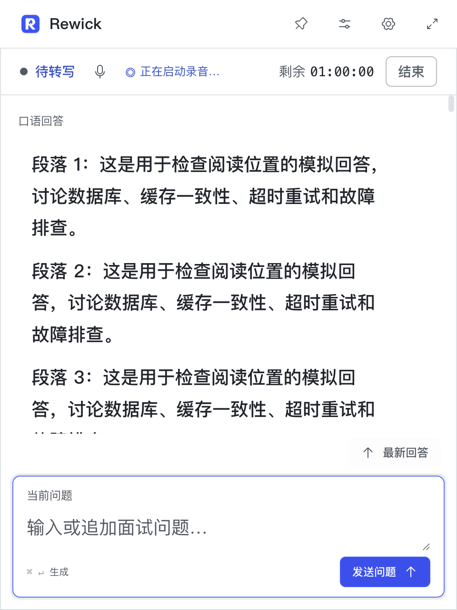

# Rewick · 掌灯

实时语音转写、回答辅助与 AI 模拟面试工作台。项目包含 Electron 桌面客户端、Web 管理端和 Java 后端。

## 项目预览

下图来自实际桌面应用的隔离演示，使用合成问题与回答，不包含真实用户会话。紧凑窗口将最新回答置顶，口语回答显示在对应问题上方。



## 功能

- **面试准备**：多份简历、目标岗位和参考资料，可组合为独立环境；支持技术面、综合面与 HR 面，以及岗位经验要求。
- **语音转写**：系统音频与麦克风输入，可用本机快捷键切换；支持手动修改转写、合并问题和自动回答。
- **资料检索**：Markdown、Word 参考资料按标题及父子片段组织；BM25 与向量各召回 Top4，RRF 融合保留 Top2，并可并发联网搜索（管理端可选择 Tavily 或 DeepSeek Search）。
- **回答辅助**：流式生成口语回答；支持平台模型和自定义服务。管理端可配置百炼或 DeepSeek 的思考模式。
- **模拟面试**：本地 2D/3D 面试官、语音提问与追问、暂停恢复，以及问答 Markdown 导出；使用独立模拟余额。
- **会话与录音**：账号内历史读取、会话导出、本机录音下载与录音复盘。录音仅在本机保存，开发版和安装版数据目录隔离。
- **管理后台**：用户、时长、套餐、支付、模型、邮件、客户端下载和运营观测。支付能力需要另行配置合法有效的商户与回调。

## 项目结构

| 目录 | 内容 |
|---|---|
| `frontend/` | Electron、React、TypeScript 桌面端 |
| `admin/` | React、Vite 管理端 |
| `backend/` | Java 21、Spring Boot、MyBatis-Plus 后端 |
| `backend/sql/` | 手动执行的数据库初始化与变更 SQL |
| `deploy/` | PostgreSQL/pgvector 镜像、Compose 与通用部署文件 |
| `scripts/backend.mjs` | Maven Wrapper 统一入口 |

三个应用模块独立版本化。桌面当前版本由 `frontend/package.json` 统一维护，为 **2.0.10**；管理端及后端目前为 **2.2.1**。macOS 与 Windows 使用相同的三段应用版本号。

## 本地开发

准备 Node.js 24、Java 21、Docker，以及可用的 PostgreSQL 15.19 / pgvector 0.8.6。依赖使用锁文件安装：

```bash
npm run install:frontend
npm run install:admin
```

后端配置参考根目录 `.env.example`。Java 不自动读取根目录 `.env`，直接运行时需要将配置传入进程环境；使用 Compose 时由 Compose 读取。生产模型、邮件和支付密钥通过管理端配置，不要写入源码。

数据库脚本由部署者按 [SQL 说明](backend/sql/README.md) 手动执行；应用不会自动创建业务表。已有业务数据库应先备份并核对已执行的脚本。

```bash
# 分别在终端启动
npm run backend:dev
npm run admin:dev
npm run dev
```

桌面开发命令会准备固定版本的本地 Python 与语音识别资源，首次执行需要网络和额外磁盘空间。当前录音运行时准备脚本支持 macOS arm64、Windows x64。

本机联调可通过 `COPILOT_PLATFORM_URL` 指向开发后端；HTTP 仅允许回环地址，远程服务使用 HTTPS。桌面与管理端需要匹配的后端、数据库及服务配置；下载桌面应用不会自动提供模型额度或可用账号。

## 验证与构建

```bash
npm test
npm run admin:test
npm run backend:test
npm run build
npm run admin:build
```

数据库集成测试需要 Docker 和项目规定的 PostgreSQL/pgvector 镜像：

```bash
node scripts/backend.mjs clean verify -Pintegration -DexcludedGroups=performance
```

桌面打包：

```bash
npm run dist                         # macOS arm64 DMG
npm --prefix frontend run dist:win   # Windows x64 NSIS，需在受支持环境中构建与验证
```

安装包发布在 [GitHub Releases](https://github.com/xc66xc/rewick/releases)，不进入源码历史。版本 Tag 会分别在 macOS arm64 和 Windows x64 环境构建，全部通过后统一发布；已发布版本可通过 Release 工作流手动指定 Tag 补充 Windows 包，不移动 Tag 或覆盖现有附件。每个包附带 `.sha256` 校验文件。

Windows 发布流程检查 NSIS 安装、安装后版本、x64 架构、内置语音运行时及应用窗口启动；真实音频设备仍需在目标电脑验收。macOS 包未完成 Apple Developer 正式签名与公证，Windows 包未使用代码签名证书。

## 配置与数据

- 不提交真实 `.env`、私钥、账号 Token、录音、数据库备份或本机运行目录。
- `AGENTS.md`、内部设计/运维记录及 Python 缓存保留本地并被忽略。
- 模型请求地址需填写完整接口路径；连接测试不代表已完成所有模型能力验收。
- 本机录音与云端会话是不同的数据，切换设备或开发/安装模式不会自动搬运录音。

## 许可证与第三方资源

项目原创源码采用 [MIT License](LICENSE)。第三方依赖和素材仍适用各自许可证，不因本仓库采用 MIT 而改变。

角色模型来源、Meshy CC BY 4.0 署名及 VRM 示例许可见 [角色资源说明](frontend/src/renderer/src/assets/interviewer-3d/README.md)。录音识别模型许可见 [模型许可证](frontend/scripts/recording-asr-model-LICENSE.txt)；打包时保留对应资源内的许可文件。

## 赞赏支持

本项目免费开源。若它对你有帮助，欢迎自愿赞赏，支持不影响功能使用。

<table>
  <tr><th>支付宝</th><th>微信支付</th></tr>
  <tr>
    <td></td>
    <td></td>
  </tr>
</table>
