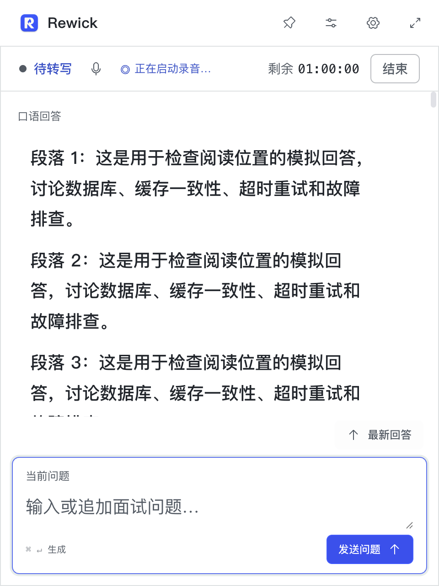
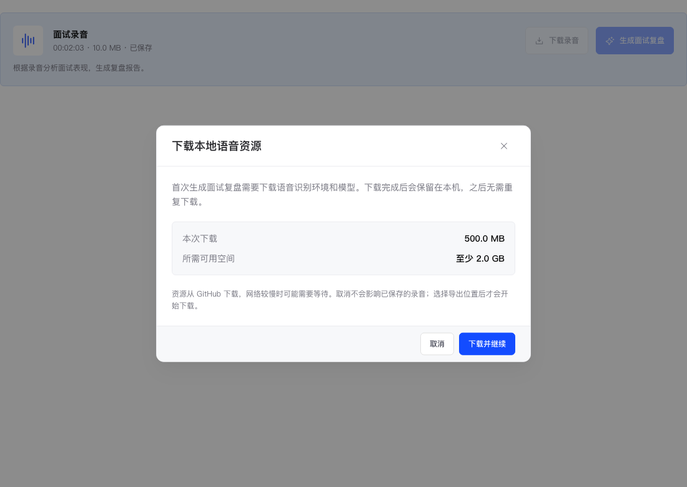
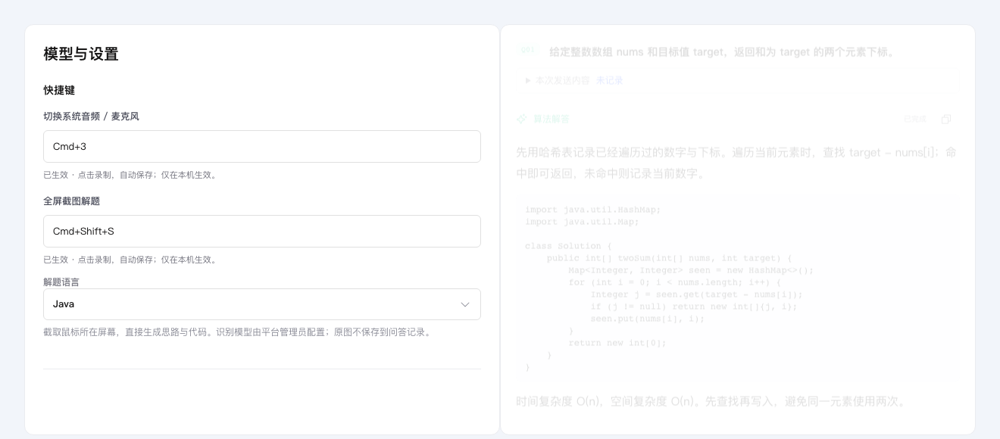
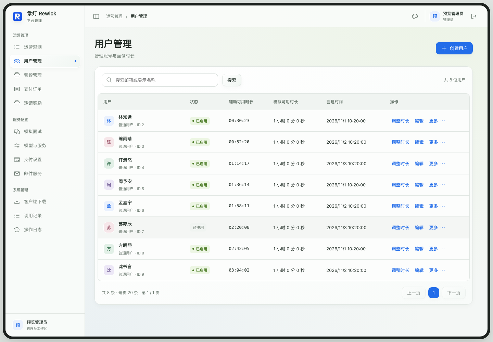
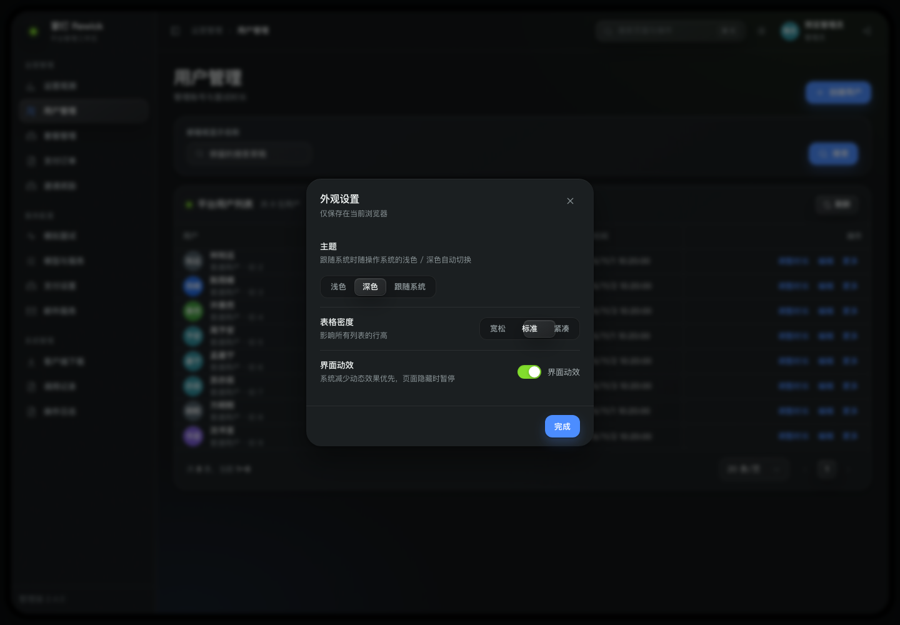

# Rewick · 掌灯

实时语音转写、回答辅助与 AI 模拟面试工作台。项目包含 Electron 桌面客户端、Web 管理端和 Java 后端。

## 项目预览

下图来自实际桌面应用的隔离演示，使用合成问题与回答，不包含真实用户会话。紧凑窗口将最新回答置顶，口语回答显示在对应问题上方；列表底部可继续滚动，直到末条问题到达内容区顶部，输入框保持固定。



<details>
<summary>首次使用本地录音复盘：下载语音资源</summary>

实际组件的隔离演示，体积使用测试数据；客户端会显示当前版本实际所需下载量与空间。



</details>

<details>
<summary>全屏截图解题：快捷键与算法回答</summary>

实际设置与回答组件的隔离预览，题目和解答为合成示例。截图快捷键在本机设置，按下后截取鼠标所在屏幕，直接识别并生成思路、完整代码和复杂度；没有框选或识别确认页。



</details>

## 功能

- **面试准备**：多份简历、目标岗位和参考资料，可组合为独立环境；支持技术面、综合面与 HR 面，以及岗位经验要求。
- **语音转写**：系统音频与麦克风输入，可用本机快捷键切换；支持手动修改转写、合并问题和自动回答。
- **资料检索**：Markdown、Word 参考资料按标题及父子片段组织；BM25 与向量各召回 Top4，RRF 融合保留 Top2，并可并发联网搜索（管理端可选择 Tavily 或 DeepSeek Search）。
- **回答辅助**：流式生成口语回答；支持平台模型和自定义服务。管理端可配置百炼或 DeepSeek 的思考模式。
- **截图解题**：自定义全局快捷键截取鼠标所在屏幕，平台视觉模型识别题目后自动交给当前回答模型；支持 Java、Python、C++、TypeScript 默认语言及连续追问。原图不长期保存。
- **模拟面试**：本地 2D/3D 面试官、语音提问与追问、暂停恢复，以及问答 Markdown 导出；使用独立模拟余额。
- **会话与录音**：账号内历史读取、会话导出、本机录音下载与录音复盘。录音仅在本机保存，开发版和安装版数据目录隔离。
- **管理后台**：用户、时长、套餐、支付、模型、邮件、客户端下载和运营观测。支付能力需要另行配置合法有效的商户与回调。

## 管理后台外观

管理后台使用 Vue 3、TypeScript、Vite 和 GSAP，直接复用 [scaffold-master](https://github.com/wbr664393425-lgtm/scaffold-master) 的珍珠玻璃样式、公共组件和核心动效，保留 Rewick 现有接口与业务功能。管理页铺满浏览器，不保留深色外框，内部玻璃材质保持，登录页与侧栏沿用原始蓝色 Rewick R 品牌图标。包含导航滑块、分段切换、页面与表格入场、点击反馈、弹窗原点展开和数字滚动；支持浅色/深色/跟随系统、三档密度及减少动态效果，偏好仅保存在当前浏览器。原项目 MIT 许可与 GSAP 独立许可说明见 [第三方说明](admin/third-party/NOTICE.md)。

隔离浏览器回归：先启动管理端，再运行 `npm --prefix admin run test:appearance`，可通过 `ADMIN_PREVIEW_URL` 指向本机生产构建。`test:web-search` 与 `test:operations` 自动启动本地静态预览并使用合成 API；需先构建。`test:smoke` 是需要专用测试账号的真实隔离后端集成验收，不能用于生产数据。 `test:login` 检查登录动画结束后的实际透明度；默认 Chromium，设置 `BROWSER_ENGINES=chromium,webkit` 可双引擎验证（先安装对应 Playwright 浏览器）。

<details>
<summary>查看新版管理后台（隔离演示数据）</summary>




</details>

## 项目结构

| 目录 | 内容 |
|---|---|
| `frontend/` | Electron、React、TypeScript 桌面端 |
| `admin/` | Vue 3、TypeScript、Vite、GSAP 管理端 |
| `backend/` | Java 21、Spring Boot、MyBatis-Plus 后端 |
| `backend/sql/` | 手动执行的数据库初始化与变更 SQL |
| `deploy/` | PostgreSQL/pgvector 镜像、Compose 与通用部署文件 |
| `scripts/backend.mjs` | Maven Wrapper 统一入口 |

三个应用模块独立版本化。桌面当前版本由 `frontend/package.json` 统一维护，为 **2.3.1**；管理端目前为 **2.5.0**，后端为 **2.3.1**。macOS 与 Windows 使用相同的三段应用版本号。

## 本机凭据存储

桌面 2.3.0 起使用随机 256 位本机密钥和 AES-256-GCM 加密登录凭据、自定义服务密钥与待同步草稿，日常启动不调用系统钥匙串。密钥存放在应用数据目录的 `local-vault-v1/key.json`，密文在同级 `data/` 下；POSIX 文件/目录权限分别为 600/700，Windows 继承用户目录 ACL。同一操作系统用户能读取密钥文件，因此此模式的隔离能力弱于系统钥匙串；不要把密钥文件提交到代码仓库。

升级不会读取或迁移旧版钥匙串凭据，需重新登录、重新填写自定义密钥；服务端历史与本机录音保留。旧 `authentication-v3/`、`accounts/` 文件保持不变，应用不提供旧数据迁移入口。

备份和恢复时必须同时保留 `local-vault-v1` 的密钥与密文，不能只拷贝配置或单独替换密钥。发现现有数据的密钥缺失、损坏或密文认证失败时应用会明确报错，不会自动生成新密钥覆盖数据。开发与打包版仍使用各自独立的数据目录。

## 本地开发

准备 Node.js 24、Java 21、Docker，以及可用的 PostgreSQL 15.19 / pgvector 0.8.6。依赖使用锁文件安装：

```bash
npm run install:frontend
npm run install:admin
```

后端配置参考根目录 `.env.example`。Java 不自动读取根目录 `.env`，直接运行时需要将配置传入进程环境；使用 Compose 时由 Compose 读取。生产模型、邮件和支付密钥通过管理端配置，不要写入源码。

数据库脚本由部署者按 [SQL 说明](backend/sql/README.md) 手动执行；应用不会自动创建业务表。已有业务数据库应先备份并核对已执行的脚本。

```bash
# 分别在终端启动
npm run backend:dev
npm run admin:dev
npm run dev
```

普通桌面开发启动不下载本地语音资源。只有开发“生成面试复盘”功能时，才需在 `frontend/` 中显式运行 `npm run prepare:recording`，准备固定版本的 Python 与语音模型；支持 macOS arm64、Windows x64。

本机联调可通过 `COPILOT_PLATFORM_URL` 指向开发后端；HTTP 仅允许回环地址，远程服务使用 HTTPS。桌面与管理端需要匹配的后端、数据库及服务配置；下载桌面应用不会自动提供模型额度或可用账号。

## 验证与构建

```bash
npm test
npm --prefix frontend run test:compact-scroll # 隔离组件与真实样式的滚动几何回归
npm run admin:test
npm run backend:test
npm run build
npm run admin:build
```

数据库集成测试需要 Docker 和项目规定的 PostgreSQL/pgvector 镜像：

```bash
node scripts/backend.mjs clean verify -Pintegration -DexcludedGroups=performance
```

桌面打包：

```bash
npm run dist                         # macOS arm64 DMG
npm --prefix frontend run dist:win   # Windows x64 NSIS，需在受支持环境中构建与验证
```

安装包发布在 [GitHub Releases](https://github.com/xc66xc/rewick/releases)，不进入源码历史。版本 Tag 会分别在 macOS arm64 和 Windows x64 环境构建，全部通过后统一发布；已发布版本可通过 Release 工作流手动指定 Tag 补充 Windows 包，不移动 Tag 或覆盖现有附件。每个包附带 `.sha256` 校验文件。

安装包不再内置本地语音环境和模型。首次点击录音的“生成面试复盘”时，经确认从固定 GitHub Release 下载匹配平台的环境包和公共模型，校验并安装到用户数据缓存；后续直接复用。录音、下载录音、实时转写与模拟面试不触发此下载。首次准备需要网络和额外解压空间；完整使用后的总磁盘占用不会因拆包而减少。

Release 流程先生成带 SHA-256 的资源清单，再构建薄安装包；Mac/Windows 原生环境分别验证解包后的语音环境和模型，Windows 另检查 NSIS 安装、安装后版本、x64 架构与应用窗口启动。实际音频设备仍需在目标电脑验收。macOS 包未完成 Apple Developer 正式签名与公证，Windows 包未使用代码签名证书。

## 配置与数据

- 不提交真实 `.env`、私钥、账号 Token、录音、数据库备份或本机运行目录。
- `AGENTS.md`、内部设计/运维记录及 Python 缓存保留本地并被忽略。
- 模型请求地址需填写完整接口路径；连接测试不代表已完成所有模型能力验收。
- 本机录音与云端会话是不同的数据，切换设备或开发/安装模式不会自动搬运录音。

## 许可证与第三方资源

项目原创源码采用 [MIT License](LICENSE)。第三方依赖和素材仍适用各自许可证，不因本仓库采用 MIT 而改变。

角色模型来源、Meshy CC BY 4.0 署名及 VRM 示例许可见 [角色资源说明](frontend/src/renderer/src/assets/interviewer-3d/README.md)。录音识别模型许可见 [模型许可证](frontend/scripts/recording-asr-model-LICENSE.txt)；打包时保留对应资源内的许可文件。

## 赞赏支持

本项目免费开源。若它对你有帮助，欢迎自愿赞赏，支持不影响功能使用。

<table>
  <tr><th>支付宝</th><th>微信支付</th></tr>
  <tr>
    <td></td>
    <td></td>
  </tr>
</table>

## 截图解题配置

1. 管理端「模型与服务」中添加支持 `image_url` 图片输入的 Chat Completions 模型，在「截图识别模型」选择该模型。可用「测试图片识别」验证读图能力，测试只发送合成数字图。
2. 桌面「模型与设置 → 快捷键」录制「全屏截图解题」组合键并选择默认代码语言，松开组合键即保存；该设置仅对本机生效。
3. 开始面试后，鼠标移到题目所在屏幕并按快捷键，题目与解答直接进入对话。Mac 首次使用须授予屏幕录制权限。确保题目、示例和约束在当前屏幕完整可见；不支持截取滚动区以外内容。

识别与回答是两次模型调用。截图仅以 JPEG 在内存中传输给平台配置的视觉服务，最长边2560、文件最多6MiB；不进入会话记录或模型输入快照。会话保存识别出的题目、回答及算法语言信息。算法解题不发送简历、转写或RAG/联网内容；手动追问保留当前截图题的完整原题，过长的历史解答明确标注节选。未配置视觉服务时返回具体提示，普通语音问答保持可用。新接口需要配套后端2.3.0和管理端2.5.0；旧平台不会自动获得截图识别能力。
